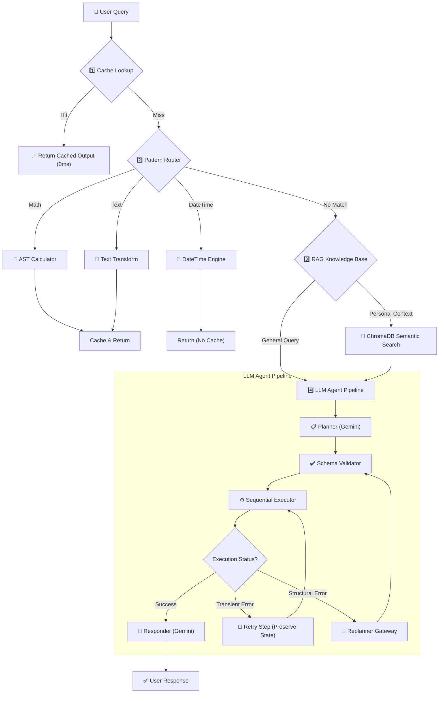

# 🤖 AI Agent Engine

> An autonomous, cost-aware AI agent built from scratch in pure Python with deterministic routing, RAG personalization, self-healing execution, and comprehensive test coverage.

[](https://www.python.org/downloads/)
[]()


---

## 💡 The Core Problem & Solution

Most AI agents send **every single user message directly to an expensive LLM**—even simple queries like *"What is 25 * 4?"* or *"What day is tomorrow?"*. This results in unnecessary API costs, slow response latency, and vulnerability to network rate limits.

**AI Agent Engine solves this with a 4-tier funnel:**

```
User Query
    │
    ▼
[ 1. In-Memory & File Cache ] ──────────► Instant match? Return result (0 tokens, 0ms latency)
    │ (miss)
    ▼
[ 2. Pattern Router (0 LLM) ] ──────────► Math, Datetime, Text? Execute locally (0 tokens, ~2ms)
    │ (no pattern)
    ▼
[ 3. Local ChromaDB RAG ] ─────────────► Personal preference? Retrieve from vector DB (~30ms)
    │
    ▼
[ 4. Defensive LLM Agent Pipeline ] ────► Multi-step reasoning: Planner ➔ Validator ➔ Executor ➔ Responder
```

---

## ✨ Key Features

### ⚡ 1. Deterministic Execution Layer (Zero LLM Calls)
Queries that can be answered with pure code bypass the LLM entirely:
- **Math Evaluation**: Evaluated using a safe Python Abstract Syntax Tree (AST) parser (no unsafe `eval()`).
- **Date & Time Reasoning**: Computes natural language dates (*"what date is 5 days from today?"*, *"what day is tomorrow?"*) locally.
- **Text Operations**: Word counts, character counts, and case transforms.

### 🧠 2. Personal Context via Local RAG (ChromaDB)
- Uses an embedded vector database (`ChromaDB` + `sentence-transformers`) stored locally in `runtime/rag_db/`.
- Queries your custom routines, focus blocks, and preferences from Markdown files without sending personal background data to external cloud APIs.

### 🛡️ 3. Defensive Self-Healing Execution Pipeline
When an LLM is required for complex tasks, queries go through a multi-stage pipeline:
1. **Planner**: Breaks user queries into sequential tool calls with explicit dependencies.
2. **Validator**: Strictly validates step schemas, parameters, and circular dependencies before execution starts.
3. **Executor with Step Resumption**: Runs steps sequentially. If a step fails due to a transient network issue, **already-completed steps are preserved** rather than re-computed from scratch.
4. **Adaptive Recovery**: Classifies errors into `TRANSIENT` (retried with exponential backoff) or `STRUCTURAL` (triggers the `Replanner` to repair the plan).
5. **Responder**: Synthesizes the final output into a clean, natural response for the user.

### 💰 4. Cost Visibility & Hard Quotas
- Real-time token tracking (prompt tokens, completion tokens, estimated USD cost).
- Daily API call limits per model with progressive warnings (50%, 80%, 100%).
- Persistent query telemetry and disk usage logs stored in `runtime/`.

---

## 🖥️ Live Example

```text
You: What is 15 * 8?
Agent: 120
⚡ Pattern matched (1 total) - 0 API calls

You: What date is 5 days from today?
Agent: March 01, 2026
⚡ Pattern matched (2 total) - 0 API calls

You: What is my best focus time?
Agent: Your morning peak focus block is between 06:00 and 13:00.
✗ Cache miss (1 total) - 2 API calls

You: What's the weather in Tokyo?
Agent: Current weather in Tokyo is 15°C with clear skies.
✗ Cache miss (2 total) - 2 API calls
```

---

## 🏗️ Architecture Overview



---

## 📂 Project Structure

```text
agent_engine/
├── app/                  # Application configuration & tool runner
│   ├── config.py         # Model limits, thresholds & safety flags
│   └── runner.py         # Tool executor with retries & error classification
├── core/                 # Agent core logic
│   ├── agent.py          # Master orchestrator & recovery loop
│   ├── planner.py        # LLM plan generation
│   ├── planner_validator.py # Schema & graph cycle validation
│   ├── executor.py       # Step execution & state resumption
│   ├── replanner.py      # Plan repair on structural failures
│   ├── responder.py      # Final response generation
│   ├── state.py          # Dynamic dependency resolution (data.value, dot paths)
│   ├── failure_classifier.py # Transient / Structural / Terminal categorization
│   ├── memory.py         # Hybrid FIFO cache & session telemetry
│   └── routing/          # Deterministic pattern matchers
│       ├── router.py     # Unified priority router (datetime ➔ math ➔ text)
│       ├── datetime_pattern.py
│       ├── math_pattern.py
│       └── text_pattern.py
├── tools/                # Registered tool implementations
│   ├── math/             # Safe AST arithmetic evaluator
│   ├── time/             # DateTime operations & natural language parsing
│   ├── text/             # Text transformations & entity extraction
│   ├── web/              # DuckDuckGo search & Open-Meteo weather
│   ├── rag/              # ChromaDB vector store client & data loader
│   ├── llm/              # Lazy-loaded OpenAI/Gemini client proxy
│   ├── registry.py       # Global tool catalog
│   └── schemas.py        # Pydantic input/output contracts
├── infra/                # System infrastructure
│   ├── env.py            # Safe environment variable loader
│   ├── logger.py         # Centralized structured logging
│   └── ui.py             # Terminal formatting & display utilities
├── prompts/              # System prompt templates
├── rag_data/preferences/ # Markdown source files for personal preferences
├── runtime/              # Local storage (cache, logs, vector DB, usage)
├── tests/                # Automated pytest suite (25 unit/integration tests)
├── pytest.ini            # Pytest configuration
├── main.py               # Interactive CLI entry point
└── requirements.txt      # Project dependencies
```

---

## 🚀 Quickstart Guide

### 1. Clone & Set Up Virtual Environment

```bash
git clone https://github.com/harshbhanushali26/ai-agent-engine.git
cd ai-agent-engine

# Create and activate virtual environment
python -m venv venv
# Windows:
venv\Scripts\activate
# Linux/macOS:
source venv/bin/activate

# Install dependencies
pip install -r requirements.txt
```

### 2. Configure Environment

Create a `.env` file in the project root:

```bash
cp .env.example .env
```

Add your Gemini API key to `.env`:
```env
GEMINI_API_KEY="your-gemini-api-key-here"
```

*(Note: The engine supports offline execution. Deterministic pattern matching, tests, and CLI help run even without an API key).*

### 3. Load Personal Knowledge Base (Optional)

Index your personal preferences from `rag_data/preferences/user_prefs.md` into the local ChromaDB database:

```bash
python -m tools.rag.loader
```

### 4. Run the Agent

Start the interactive terminal session:

```bash
python main.py
```

### Available CLI Commands:
- `help` / `?` — View available commands and query examples
- `stats` — Display cache hits, pattern match counts, and bypass rates
- `usage` — Display 7-day model call usage and quotas
- `exit` / `quit` — Save session telemetry and exit

---

## 🧪 Running Automated Tests

The repository includes a comprehensive `pytest` suite testing state dependencies, step-resumption, failure classification, and pattern matchers:

```bash
python -m pytest
```

Expected output:
```text
============================= 25 passed in 16.91s =============================
```

---

## 🛣️ Roadmap

- [x] Deterministic routing (Math AST, DateTime NLP, Text)
- [x] Local RAG personalization (ChromaDB + SentenceTransformers)
- [x] State-preserving retry loop & step resumption
- [x] Automated test suite & dynamic dependency resolution
- [ ] Multi-turn conversation context history
- [ ] Rich terminal UI components (tables, markdown cards, spinners)
- [ ] Streaming response generation
- [ ] Asynchronous tool execution


---

## 👤 Author

**Harsh Bhanushali**
- GitHub: [@harshbhanushali26](https://github.com/harshbhanushali26)
